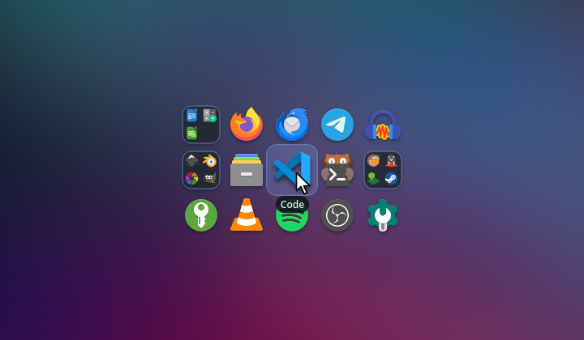
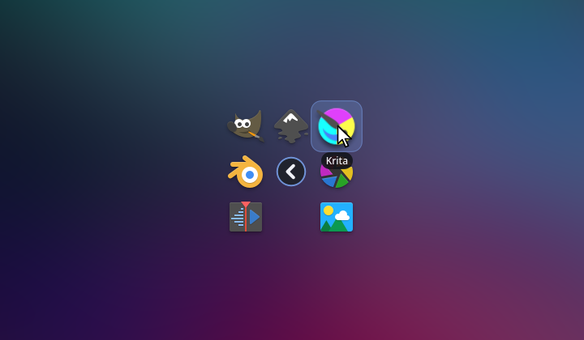
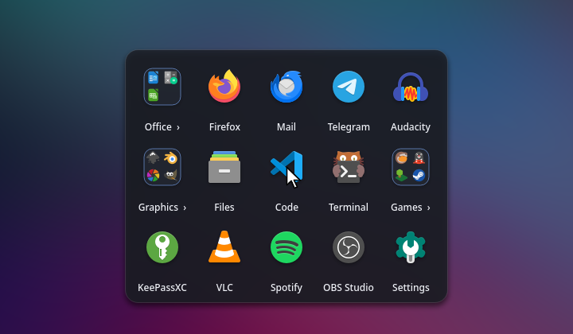
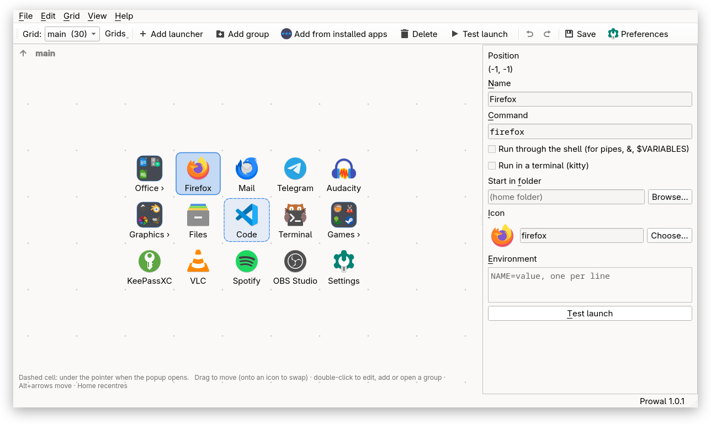
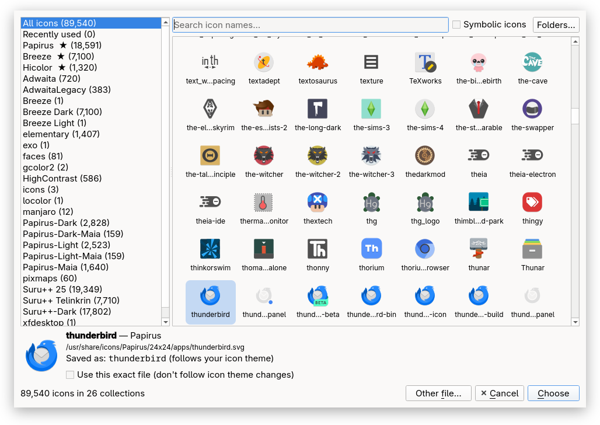
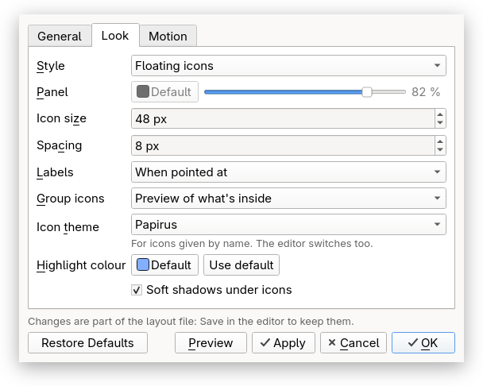

# Prowal

A pop-up application launcher for Linux/X11. Press a key and a grid of icons appears around the
mouse pointer; every icon keeps a fixed position relative to the pointer, so after a while you
launch things by muscle memory: key, flick, click. A spiritual successor to *apwal*, and it
imports apwal layouts.

**Version 1.0.1**



- Opens in ~30 ms, with a short bloom animation, soft shadows and hover labels (all optional).
- **Groups:** icons that open their own grid in place, nested as deep as you like.
- **Named grids:** different keys can open different launchers (`prowal --grid games`).
- **Mouse or keyboard:** arrow keys and Enter work as well as clicks.
- **An editor that opens instantly:** drag-and-drop layout, undo for everything, add programs
  from your installed apps or by dragging `.desktop` files and programs in, and an icon browser
  that shows every icon on the system.
- **Preferences** for the terminal, the look and the motion, with a live preview.

<p>
  
  
</p>

## Install

Prowal needs Qt 6.4 or newer (Widgets) and X11 (or XWayland).

**From a release:** download `prowal-<version>-linux-x86_64.tar.gz` from the
[releases page](https://github.com/subbaan/prowal/releases), unpack it and put `prowal`
somewhere on your `PATH` (and `prowal.1` in a `man1` directory if you like). The release binary
is built on Arch/Manjaro against a current Qt 6 and needs at least that Qt version at run time
(Arch/Manjaro `qt6-base`); on distributions with an older Qt, build from source.

**From source:**

```sh
# Arch/Manjaro: sudo pacman -S --needed qt6-base cmake ninja libxcb
# Debian/Ubuntu: sudo apt install qt6-base-dev cmake ninja-build libxcb1-dev libxcb-shape0-dev
make            # Release build in build/, ./prowal symlink in the project root
make test       # unit tests
./prowal        # try it
```

`cmake --install build` installs the binary, man page and an editor menu entry, for packagers.
Other targets: `make debug` (warnings as errors), `make sanitize` (ASan/UBSan build and tests),
`make dist` (release tarball in `build/dist/`).

## Set it up

Bind `prowal` to a key (or a mouse button) in your desktop:

- **Xfce:** Settings → Keyboard → Application Shortcuts → Add, command `prowal`.
- **KDE Plasma:** System Settings → Shortcuts → Add New → Command or Script.
- **GNOME:** Settings → Keyboard → View and Customise Shortcuts → Custom Shortcuts.
- **Mouse buttons:** e.g. with `xbindkeys`: `"prowal"` / `b:9`.

On first run Prowal imports `~/.apwalrc.xml` if there is one (it only reads it), otherwise it
starts with an empty grid: right-click in the popup, or run `prowal --edit`, to fill it.

## Using the popup

| | |
|---|---|
| **Left click** | launch, then close |
| **Middle click** / **Shift+Enter** | launch and keep the popup open |
| **Right click** | open the editor on that icon |
| **Arrow keys**, **Home** | move the highlight; Home goes back to the middle |
| **Enter** / **Space** | launch the highlighted icon, or open the group |
| **Esc** / **Backspace** | go back out of a group; Esc at the top closes |
| **Click outside, or in a gap** | close |

Moving the pointer off the grid closes the popup after the timeout (not while you're using the
keys). Programs that aren't installed are greyed out.

**Groups** (icons with a small grid badge) open their own icons in place, centred on the group's
icon. If a group leaves its middle cell free, that cell becomes a Back button.

## The editor

`prowal --edit`, or a right click in the popup. If it's already open, it comes forward and shows
what you right-clicked instead of opening twice.



- The dashed cell is where the pointer will be when the popup opens.
- Drag icons to move them (drop on another icon to swap). Double-click to edit, to add in an empty
  cell, or to open a group. Delete removes, Ctrl+T test-launches, Ctrl+Z / Ctrl+Shift+Z undo and
  redo, Ctrl+S saves.
- **Add from installed apps** (Ctrl+I) lists the applications in your menus. You can also drag
  `.desktop` files or programs in from a file manager, or drop an image onto an icon to use it.
- **Choose…** next to Icon opens a browser of every icon in your icon folders, searchable, with
  thumbnails loading in the background. Icons from your current theme are saved by name, so they
  follow theme changes.
- **Groups:** Add group (Ctrl+G). The bar above the grid (main › Tools › …) or Backspace takes you
  back out. Right-click an item → Move to, to put it into a group or take it out.
- **Grids** (`prowal --grid NAME`) are managed from the Grid menu; `main` is the default.
- **Preferences** (Ctrl+,): the terminal for launchers marked "Run in a terminal" (with a Try it
  button), the close timeout, floating icons or a panel, sizes, labels, group icon style, icon
  theme, colours, shadows, animation and its speed. **Preview** shows the popup with the new
  settings before you apply them.

<p>
  
  
</p>

Launchers run their command directly (shell-style quoting, `~` expanded, a `# comment` at the
end is ignored, as in apwal). Tick **Run through the shell** for pipes, `&&` or `$VARIABLES`.

## Files

- `~/.config/prowal/prowal.json`: the layout and preferences. Hand-editable; unknown keys are
  kept. Each save first copies the previous version to `~/.config/prowal/backups/` (last 10).
- `~/.config/prowal/icon-picker.ini`: the icon browser's folders and recent icons.
- `prowal --import-apwal [FILE] [--grid NAME]` (re)imports an apwal layout; it replaces that
  grid's items, after a backup.

`man prowal` (or `man -l build/prowal.1`) has the full reference. `PROWAL_TRACE_STARTUP=1`
prints start-up timings.

## Troubleshooting

- **The popup fades in slowly (picom):** picom's own fading adds to Prowal's animation. Add a
  rule to `picom.conf`: `rules: ({ match = "class_g = 'prowal'"; fade = false; })`.
- **No transparency, shadows or animation:** no compositor is running. Prowal then shows plain
  icons cut to their shapes. Turn on your desktop's compositor for the full look.
- **"Run in a terminal" does nothing:** set the terminal in Preferences and press Try it.
- **An icon shows a question mark:** the icon isn't in your icon theme. Pick another with
  Choose…; for apps added from your menu, Prowal uses the app's current icon if its old one
  disappears.

## Licence

Prowal is free software: you can redistribute it and/or modify it under the terms of the GNU
General Public License as published by the Free Software Foundation, either version 3 of the
License, or (at your option) any later version (GPL-3.0-or-later). It is distributed in the hope
that it will be useful, but WITHOUT ANY WARRANTY; see `LICENSE` for the full text.

Prowal is written from scratch: it contains no code, images or text from apwal.

## Thanks

Thank you to Pascal Eberhard, who wrote apwal (2002–2004). I used it every day for twenty years,
and Prowal exists because I didn't want to stop.

## Development

See `project.md` (spec and roadmap), `ARCHITECTURE.md` (how it's built, gotchas, testing
method) and `CHANGELOG.md`.
